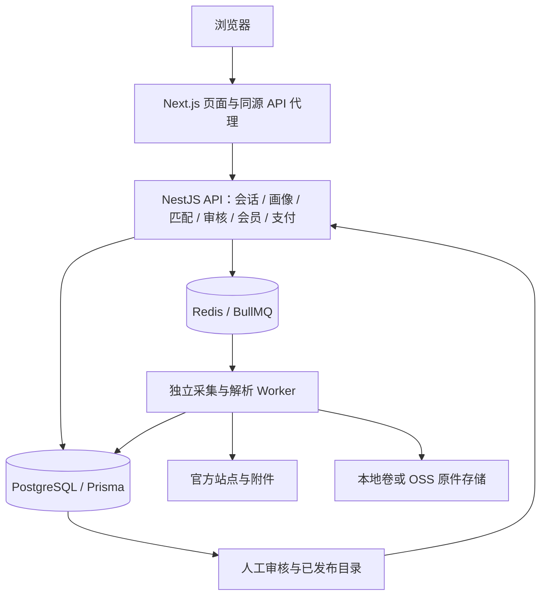

# 教招有据

面向教师招聘考生的官方机会发现、可解释资格预筛与报考推进工具。当前匹配只开放语文学科；全国是逐步扩源目标，实际服务以运行时覆盖和最近核对时间为准。所有结论均为预筛，最终以招聘单位审核为准。

产品要求统一维护在 **[PRD.md](PRD.md)**。本文介绍当前架构与开发入口，不代表生产已部署或商业服务已开放。

**分支说明：** 当前功能盘点基于 [`codex/modular-development`](https://github.com/CHEN-Cowen/chinese-teacher-exam-assistant/tree/codex/modular-development)。`main` 本轮仅同步文档整理，尚未合并该分支的业务代码；开发和运行最新功能请使用对应开发分支。

## 当前状态

截至 2026-10-27，开发分支已包含来源采集、审核发布、画像匹配、报考推进、账号恢复、燕麦可可棕视觉、会员及模拟支付等实现。

- 现有 11 个官方来源适配器，覆盖浙江、江苏、安徽部分地区，证据等级不同；连续 7 天线上采集观察尚未完成。
- 订单、权益授予、全额退款和手动对账有模拟链路。**真实微信渠道尚未实现，当前只有 `wechat_mock`**；Native/JSAPI/H5 是预留标识。
- 会员增值权益清单为空，售卖默认关闭；价格配置不代表可以收费，年卡另有独立开关。
- SMTP、线上 HTTPS 会话、生产迁移/回退及真实发布流水线等仍需验证。
- 本地集成结果见 [历史验收报告](docs/final-e2e-acceptance-report.md)；本次文档整理未重跑应用测试，不将历史报告作为当前线上证明。

## 技术架构

前后端同仓库，分别安装、构建和运行；后端 API 与采集 Worker 是两个独立进程。



浏览器调用同源 `/api/*`，Next.js 服务端注入内部令牌访问 API。API 执行会话与管理鉴权、业务读写和任务投递；Worker 执行安全抓取和材料解析；用户匹配消费正式发布目录。

| 层 | 当前技术 |
|---|---|
| 前端 | Next.js 16.3.8、React 19.2.8、TypeScript、Tailwind CSS 4 |
| API | NestJS 12、ESM、Prisma 6、PostgreSQL（部署模板使用 17） |
| 任务 | BullMQ、Redis、Nest 定时投递、独立 Worker |
| 解析 | Cheerio、pdfjs-dist、SheetJS、Mammoth；OCR 保留人工回退 |
| 存储 | 本地快照卷及 OSS 实现，数据库保存业务与发布版本 |
| 测试 | Vitest、后端 oxlint、前端 ESLint、Playwright |
| 部署 | Node.js 24 容器、GitHub Actions/GHCR、Docker Compose；按形态由 Caddy 或既有反代提供 HTTPS |

依赖精确版本以两份 package.json 与 lockfile 为准。

## 仓库结构

```text
.
├── PRD.md                     # 唯一产品需求基线
├── AGENTS.md                  # 开发约定与文档入口
├── src/
│   ├── app/                   # 页面、管理端、同源 API 代理
│   ├── components/            # 业务和基础 UI
│   └── lib/                   # 画像、匹配、机会、日程、账户等
├── backend/
│   ├── src/
│   │   ├── auth/ profile/ opportunities/ matching/
│   │   ├── announcements/ sourcing/ catalog/ document-processing/
│   │   ├── membership/ payments/ schedule/ plans/ trial/
│   │   ├── app.module.ts      # API 模块入口
│   │   └── worker.ts          # 独立 Worker 入口
│   ├── prisma/               # Schema 与迁移
│   └── test/
├── e2e/                       # 浏览器关键流程
├── scripts/                   # 构建检查与运维辅助
├── deploy/                    # Compose、反代和环境模板
└── docs/                      # 技术、网络、来源与历史验收
```

## 本地开发

准备 Node.js 24 和 npm；需要真实服务端时准备 PostgreSQL、Redis。环境文件仅存本机，真实密钥不提交。

### 前端演示

```bash
npm ci
npm run dev
```

默认 `http://localhost:3000`。demo 模式使用本机浏览器数据与明确示例，不代表真实招聘；管理端与代理受模式限制，不用于承接正式用户。

### API 与 Worker

在 backend/ 下根据 `.env.example` 创建 `.env`，配置数据库、Redis、认证、内部令牌和快照目录，确保 CLI 与运行进程能读取环境。

```bash
cd backend
npm ci
npx prisma generate
npx prisma migrate deploy
npm run start:dev
```

后端 PORT 默认 3000；与前端同机运行时应在后端环境设为例如 3002。另开终端启动 Worker，共用数据库、Redis 和存储：

```bash
cd backend
npm run build
node dist/worker.js
```

根目录前端 `.env.local` 联调示例：

```dotenv
NEXT_PUBLIC_AUTH_MODE=invited
BACKEND_URL=http://127.0.0.1:3002
INTERNAL_TOKEN=replace-with-the-same-strong-local-token-as-backend
```

后端对应 `AUTH_MODE=invited`，内部令牌保持一致。账号初始化、公开注册和代理配置见 [部署说明](DEPLOYMENT.md)，公网不使用演示默认凭证。

## 模式与开关

- demo 是本机演示；invited 使用真实会话和服务端数据，失败不回退 Mock。
- 前端 `NEXT_PUBLIC_*` 在构建期内联，变更需重新构建，不能包含密钥。
- 六个开关为 `NEW_HOME`、`NEW_RESULTS`、`TARGETED_SUPPLEMENT`、`DB_CATALOG`、`ACTIVE_CRAWL`、`POST_SAVE_NEXT`，共同前缀 `NEXT_PUBLIC_FF_`。除目录开关外，非显式 true 默认关闭。
- DB_CATALOG 未设置时 production 开、dev/test 关，后端对应 `FF_DB_CATALOG`。开启消费已发布数据库目录；关闭路径用于演示/测试静态目录。
- 前端来源管理开关不等于暂停 Worker；实际由 `CRAWL_SCHEDULER_ENABLED`、`CRAWL_WORKER_PAUSED` 等控制，部署时协调。
- `MEMBERSHIP_SALES_ENABLED` 与 `MEMBERSHIP_ANNUAL_SALES_ENABLED` 默认关闭。`PAYMENT_MOCK_ENABLED` 仅供受控测试，生产禁止。真实微信不是当前可配置即用能力。

完整变量见 [后端模板](backend/.env.example)、[部署模板](deploy/.env.example)、[前端容器模板](deploy/frontend.env.example)。

## 检查与测试

前端根目录：

```bash
npm run lint
npx tsc --noEmit
npm test
npm run build
npm run test:e2e
```

build 后自动检查外部依赖。test:e2e 的 pretest 会预构建，当前浏览器测试使用 3001（回退态）和 3123（新流程）端口。首次使用安装浏览器：`npx playwright install chromium`；避免其他服务占用端口。

后端：

```bash
cd backend
npm run lint
npm test
npm run build
npx prisma validate
```

fixture、真实材料、模拟支付与线上观察分别记录；缺快照而跳过不算通过，expected fail 仍代表未落地目标。静态检查可能扫描本机调试目录，先核对范围，不删除他人文件制造通过。

## 部署与文档

部署包含迁移、API、Worker、PostgreSQL、Redis 和原件存储。API/数据库保持内网隔离，可信反代提供 HTTPS。迁移前备份，回退优先使用兼容代码并保留业务数据，不直接删除支付或审核记录。

| 文档 | 用途 |
|---|---|
| [PRD](PRD.md) | 当前完整定位、范围、流程、视觉、商业与验收 |
| [部署说明](DEPLOYMENT.md) | 环境、开关与发布 |
| [容器部署](deploy/README.md) / [独立部署](deploy/STANDALONE.md) | 部署拓扑与运维 |
| [国内网络基线](docs/china-network-accessibility.md) | 依赖与验证 |
| [来源验收](docs/m08-source-acceptance-report.md) | 来源证据与持续观察缺口 |
| [集成验收](docs/final-e2e-acceptance-report.md) | 历史本地测试及待生产验证 |
| [开发记录](docs/development-execution-log.md) | 模块交付、提交与受阻历史 |

旧 PRD、阶段商业化方案、分模块提示词和生成效果图已从当前文件树移除，可通过 Git 历史追溯。后续产品变更直接更新 PRD，不新增并行需求基线。
