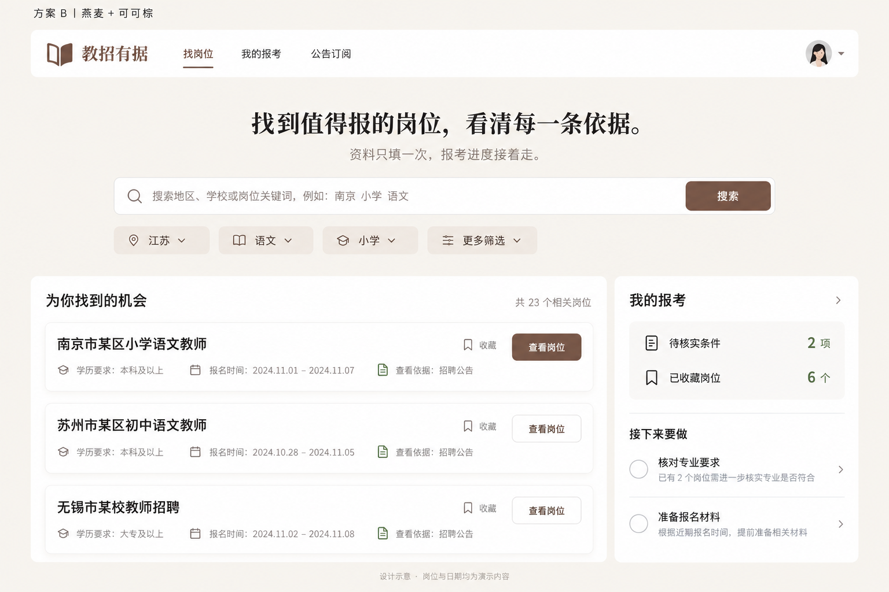

# 教招有据：项目体检与商业化整体方案

日期：2026-10-26。本文为方案稿，不修改应用代码、数据库、部署配置或现有需求基线。

## 1. 决策建议

保留“官方机会发现 → 可解释资格预筛 → 报考推进”的定位。按用户最新要求，首先将七项问题全部列为 High，并把全国官方来源的持续抓取、更新和可信发布作为首要建设方向；其次制作页面布局优化第一版；最后上线免费基础服务与限期会员。按最新澄清，月卡为一个月而非三天；建议首发定价：30 天 ¥29、90 天 ¥59、365 天 ¥169，手动续购。全国扩源分批验收并公开实际覆盖，不以一次性全国零遗漏为承诺。大题库和复杂自动续费后置。

当前更接近有真实数据供应链的试点产品，尚不能认定为完成商业上线验收的全国服务。优势是证据链、人工审核和不确定性处理；付费价值应是节约持续核对和多岗位管理的时间。

## 2. 检查范围与证据边界

- 本地 HEAD 与本地缓存的 target/main 均为 `c053e0a0`。target 指向用户提供的 GitHub 仓库；origin 指向另一个带 `-project` 后缀的仓库。
- 本轮直接访问 GitHub 页面未成功，远程引用查询也受本机代理连接失败影响。因此不能证明 GitHub 此刻没有更新，以下是本地可核实版本的结论。
- 检查了提交记录、未提交差异、v7.0/v7.1/v7.2 需求、原型说明、实施追踪、网络基线、来源监测与对账文档，以及关键前后端代码和发布流程。
- 代码存在不等于当前线上已开启；没有读取生产数据库、部署环境和线上浏览器会话，不能确认生产 Flag、公告数量、支付资质或线上体验。
- 本地有既有未提交修改和大量调试/试用文件。本轮保留原状，不把这些文件视为已推送或已部署。
- 网页研究以产品官网、Product Hunt 产品页和官方支付文档为依据。页面建议是基于其产品结构的设计推导，不是逐像素视觉审计。

## 3. 目前做了哪些修改

| 改动阶段 | 可核实内容 | 对产品的意义 |
|---|---|---|
| v7.2 决策体验 | 结果先行首页、两屏画像、三类结果工作台、定向补充、保存后一个下一步、访客迁移 | 从“看信息”转向“得到判断并行动” |
| 公告审核闭环 | 抓取快照、附件标准化、候选字段与证据、审核工作台、发布版本、目录投影 | 人工审核后的真实公告可以进入用户匹配 |
| 10 月 21—22 日稳定性 | 南京适配器和 PDF 表格、公开注册、注册白名单、队列任务 ID、迁移和字段映射修正 | 修复演示和部署中暴露的流程故障 |
| 10 月 22—24 日数据链路 | 对象存储快照读取、自动材料包、审核后正式发布、缓存重试、运行审计、四来源验收 | 从采到链接推进到材料与审核成果复用 |
| 10 月 26 日扩源 | 新来源适配与回放、第二轮栏目检查、南京/丽水独立对账试点 | 已有 11 个 ready 来源的代码/取证记录，但还不是 11 个来源全链路质量达标 |

近期主要提交：`a2ec3ad6` 材料包、`559cb693` 审核发布、`9afd8178` 缓存重试与审计、`aa61036a` 四来源验收、`366e7691` 扩源与监测、`d9e402a5` 蚌埠/萧山与第二轮检查、`c053e0a0` 独立对账试点。

既有未提交行为改动：表头排除“岗位职责”；Excel 使用实际有值单元格收紧范围并升级解析器版本；测试替身补充来源关系；仅演示模式追加学位与就业状态。它们需要独立验收，尤其不能让演示体验要求倒逼真实用户首次填写变长。

## 4. 已确认问题与修复方案

用户最新决策：F1—F7 全部为 High，均纳入首阶段修复与验收；下列顺序保留问题编号，不代表可以跳过后几项。High 是实施优先级，不改变证据强弱：代码已确认、部署推导与线上待验仍分别标记。

### F1 / High：匿名覆盖接口被全局登录守卫拦截

证据：`backend/src/opportunities/opportunities.controller.ts` 的 `GET coverage` 声明为首页公开接口；`backend/src/auth/session.guard.ts` 的 PUBLIC_PATHS/PUBLIC_PATTERNS 未包含 `/opportunities/coverage`；`src/app/page.tsx` 在 invited 模式匿名请求它，非成功响应静默回退。

影响：新用户拿不到最新覆盖摘要，页面继续显示旧镜像，不易被察觉。

修复：只放行这个只读精确路径；补匿名/登录/非公开接口权限回归；失败时显示最近成功数据时间与“暂未更新”，不得把回退描述成实时信息。验收：无 Cookie 时该接口成功，个人关注和订阅接口仍受保护。

### F2 / High：扩源台账与用户端覆盖范围不一致

证据：`backend/src/matching/coverage.ts` 核对时间仍为 10 月 6 日，江苏仍标为尚未监测；`src/lib/guest/coverage.ts` 复制同一旧口径；`OpportunitiesService.coverage()` 仅用目录更新在报数量，地区与来源仍由旧 coverage 结构提供。新来源台账已含南京、苏州、常州、蚌埠等记录。

影响：后台已登记/核验的来源，前台可能仍显示未覆盖；来源数与岗位数也可能来自不同时间、不同口径。

修复：建立一个可供前台使用的服务端覆盖投影，分别显示“已登记、核验通过、近期检查正常、已有人工发布岗位”；仅把达到对应条件的来源计入相应统计。访客与登录用户使用同一版本。前端静态镜像只能用于明确标识的演示或带时间的回退。

验收：新增、暂停、失败、撤回来源后，不改前端代码也能更新摘要；来源已接入但没有已发布岗位时不得显示“当地没有招聘”。

### F3 / High：目录监测状态使用代码内历史检查记录

证据：`backend/src/sourcing/sourcing.controller.ts` 的 catalog() 对 `SOURCE_MONITORING_RECORDS` 汇总；这些记录写在 `source-catalog.ts`。追加工具的调用主要在测试中，目录接口并未直接读运行时 CrawlRun。`summarizeMonitoring()` 依靠连续成功次数，没有按当前时间判断记录过期。

影响：即使后续 Worker 停止或失败，目录仍可能展示历史“monitoring”；这与已有运行健康查询形成两种事实来源。

修复：历史取证记录保留为验收证据；线上状态由数据库运行记录、来源暂停状态、最近成功和下次计划推导。按每个来源抓取周期设过期窗口，过期显示“检查超时/待确认”，不能一直正常。

验收：模拟停止 Worker、一次失败、结构变化和主动暂停，目录状态与健康页一致，重启后状态不丢失。

### F4 / High：端到端测试失败不阻断镜像发布

证据：`.github/workflows/docker-publish.yml:92` 为浏览器测试配置 `continue-on-error: true`，注释记载当时有 13 个既有失败。这个数量是历史记录，不能当作本轮实测失败数量。

修复：先归类为产品缺陷、测试选择器过期、环境/时区问题；修复后恢复阻断。关键门槛至少覆盖匿名匹配、登录迁移、补充重算、人工发布进入匹配、延期/撤回影响、日程去重、移动端。支付上线后加入支付及退款链路。

验收：任一关键流程失败不得发布正式镜像；演示与正式版本的发布策略明确分开。

### F5 / High：HTTPS 信息在 Next 到后端代理时丢失

证据：Caddy 把全部流量交给 Next；`src/app/api/[...path]/route.ts` 只转发有限头部，不含可信转发协议；后端 Cookie 使用 `secure: req.secure`。在文档所示的 HTTP 内网代理拓扑下，后端可能把公网 HTTPS 登录识别为 HTTP。

影响：会话 Cookie 可能缺少 Secure 属性。这是代码与拓扑推导，尚未检查线上实际 Set-Cookie。

修复：由可信代理重建协议，或在正式环境强制安全 Cookie 并明确开发例外；不能原样信任任意客户端提供的转发头。验收：真实 HTTPS 链路的 Cookie 含 Secure/HttpOnly/SameSite，HTTP 正式入口不允许登录。

### F6 / High：Excel 扫描预算不能约束空区域遍历

证据：`spreadsheet-document.parser.ts` 按矩形范围遍历；`budget.spend()` 只在遇到非空有效单元格后执行。既有未提交的 usedCellRange() 能缩小常见虚大 !ref，但两个相距极远的有值单元格仍会形成大矩形；全空表还会回退到 !ref。

影响：稀疏或异常表格可能耗费大量 CPU，阻塞解析 Worker；不能仅凭 maxCells 判断已防住此类输入。

修复：按实际单元格地址迭代；另设行列跨度、总访问次数、文件解压预算和任务超时/进程隔离。用极端稀疏、全空虚大范围和合并单元格样本验收，超过预算进入待人工处理。

### F7 / High：公开注册仍是比赛体验级能力

证据：注册仅检查邮箱非空和密码至少 6 位；未在应用代码中找到注册/登录限速、邮箱验证、找回密码链路。是否有网关补偿防护尚未核实。

修复：校验邮箱格式与字段长度、认证接口限速、按风险触发验证、邮箱所有权验证和安全密码重置；并发重复注册转为可理解的冲突提示。付费订单绑定稳定 userId，不绑定可变邮箱字符串。找回密码不得直接开放未验证邮箱的账户接管路径。

## 5. 必须补验收的能力，不应误标成缺陷

- 独立对账：南京/丽水清单仍是 pending，只有栏目发现对账，未逐条下载正文附件；文档明确材料完整率分子为 0。不能宣传 100% 召回或完整材料。先由另一人核清分母，再验证附件与发布。
- 11 个 ready 来源不等于全国覆盖，也不等于 11 个来源均持续全链路运行。
- OCR 目前有接口与人工回退，不等于供应商已接入；不要以扫描件自动识别作为现有付费权益。
- 主 PRD 仍写“代码尚未实现”，实施追踪却记载 WP0–WP5 已实现；S5 首批扩源文档仍停留 9 个来源/未有持续记录的旧结论。应按“设计范围/实现状态/部署状态/实测状态”分栏维护，避免继续按过期状态开发。
- 当前禁止搜索收录是试用期设计，并非代码错误；商业官网上线需单独开放营销页，账号、画像、管理后台和私人结果页继续禁止收录。
- 仓库有试用账号、录制输出和调试日志等本地文件。未检查其内容，不能断言泄露；公开提交前应检查是否含真实个人资料/凭证，整理可提交与仅本机保留的边界。

## 6. 页面与品牌方向

### 参考产品

| 产品 | 调研入口 | 借鉴点 | 在教招有据中的转化 |
|---|---|---|---|
| Jobright | [Product Hunt](https://www.producthunt.com/products/jobright-ai-2)、[官网](https://jobright.ai/) | 匹配价值先出现、开始体验入口清晰、用产品结果解释价值 | 首页展示“结论—依据—下一步”的短结果卡，突出免费开始 |
| Huntr | [Product Hunt](https://www.producthunt.com/products/huntr)、[官网](https://huntr.co/) | 求职过程管理、状态与活动聚合 | 将关注岗位组织成报考进度；保留一个最重要的待办 |
| Simplify | [Product Hunt](https://www.producthunt.com/products/simplify-3)、[官方帮助](https://help.simplify.jobs/en/help/articles/2830264-viewing-jobs-on-simplifys-job-board) | 个人资料复用、发现与行动相连接 | 两屏画像后进入结果，缺哪项只补哪项，不重复填写 |
| Teal（补充参考） | [官网岗位追踪器](https://www.tealhq.com/tools/job-tracker)、[官方入门](https://help.tealhq.com/en/articles/9508859-getting-started-job-tracker) | 列表式岗位管理和任务组织 | 桌面用高信息密度列表，移动用简洁卡片；多岗位比较后续验证 |

以上为结构启发，不能将海外求职产品的价格、转化率或自动投递承诺直接套用。教师招聘的核心仍是规则与官方证据。

### 公共首页

建议顺序：简洁导航 → 一句话价值与唯一高强调开始按钮 → 一张短结果示例 → 当前真实服务范围 → 三步流程 → 用户可核验的证据说明 → 服务价格 → 常见问题与经营主体/联系/协议。

建议标题：“找到值得报的教师岗位，看清每一条报考依据。”副标题明确“当前开放语文学科，覆盖范围持续扩展；资格以招聘单位审核为准”。减少“现在就能报”的确定性暗示。30 秒表述需有真实完成时长数据后再承诺。

免费开始仍是首屏主操作，价格为次级导航；不要在用户看到第一份有效结果前强制登录或购买。示例明确写“示例”，不使用“刚刚核对”营造真实更新错觉。真实动态计数必须标注统计范围和更新时间。

### 登录后的结果工作台

桌面保留现有收敛导航，不增加一排商业功能：左侧机会/日程/我的；中间筛选与三类互斥结果；右侧按用户选择展示短详情或下一步。无选中项时不强塞仪表盘。右侧栏不能挤压列表阅读；窄屏改抽屉或详情页。

岗位行优先级：地区学校/分配方式 → 状态与截止时间 → 学段学科和用工 → 一条关键依据 → 一个动作。证据、附件和版本变更进详情，不把所有字段堆在首层。

移动端保留机会/日程/我的三个底部入口；筛选采用抽屉，详情底部只保留当前主动作。来源、截止和重要不符原因不能因折叠而消失。覆盖不足、网络失败、无招聘和资格不符分别表达。

### 商业页面与会员入口

价格页写清：免费已有价值、会员新增能力、覆盖地区和学科、有效期、提醒渠道、取消与退款规则。我的页面放会员状态、到期日、订单和售后入口。用户主动选择高级筛选、导出或高级管理时再出现上下文升级提示。

视觉采用用户已选定的方案 B「燕麦＋可可棕」（色值与验收见 12.6），沿用系统字体和本地 SVG；用留白与层级提高可信度。颜色区分资格状态，付费状态另用文字标签，避免把“付费”误解成“更符合资格”。不添加远程字体/CDN依赖。

## 7. 商业模式与定价实验

按用户最新要求，90 天调整为 ¥59；一个月 ¥29 建议明确按 30 天计费，避免自然月长短差异。推荐首发提供免费版、30 天 ¥29、90 天 ¥59，并增加建议价 365 天 ¥169 的年卡。配额及商业效果仍需验证，不能将定价决策当作已验证的支付意愿。

| 模式 | 谁为何付费 | 建议实验 | 风险与优先级 |
|---|---|---|---|
| 报考季会员 | 同时关注多个地区/岗位、需持续跟踪的考生 | 90 天 ¥59，单次购买，手动续购 | 主推；需证明持续服务，存在季节性流失 |
| 月度会员 | 只需处理当前报名窗口的考生 | 30 天 ¥29，和季卡并列 | 让用户自主选期限，不用默认勾选或虚假倒计时逼选 |
| 年度会员 | 跨春秋招聘季、计划长期跟踪机会的考生 | 建议 365 天 ¥169，单次购买，手动续购 | 季卡仍作主推；年卡需有持续维护和服务保障，不承诺未来地区或功能 |
| 按次人工资料核对 | 专业/身份等复杂情况、需要整理证据的用户 | 单批次 ¥49 起，明确交付清单、时限与退款条件 | 小规模测试；不保证官方审核结论，人工成本可能过高 |
| 机构席位 | 合规辅导机构/高校就业服务团队 | 访谈 3—5 家后再做报价试点 | 后续；涉及授权共享、角色权限和较长销售周期 |

不建议首发广告/卖线索：广告可能干扰中立推荐，出售考生资料也损害信任。机构模式若开展，只允许用户明确授权的资料共享，不出售个人画像。

建议免费保留：官方公告与来源、基础资格预筛、明确不符原因与不确定项、定向补充、基础收藏、站内日程和重大变更提示。已有用户权益不应突然收回。

建议收费候选：多组地区/偏好方案、批量管理、多岗位对比、个性化导出、增强历史变更对照、经验证的离站提醒。比较、导出、离站通知若未实现，必须标注拟开发，不能先售卖。

不把“资格判断更准确”“提前看到官方变更”“重大取消不通知免费用户”做成付费差异。会员买的是便利和持续服务，所有用户共享同一事实与判断标准。

### 单位经济模型

不凭空估计实际 CAC/LTV。按每笔订单记录收入、退款、渠道费、短信/OCR/AI成本、客服与审核工时分摊。以 90 天 ¥59 为示例：若支付、通知、计算、存储和审核/客服分摊合计 ¥17，则获客前贡献 ¥42；若每位付费用户获客成本 ¥20，则首单剩 ¥22。这里所有成本均为演算假设，需以账单和工时替换，税费及固定研发另计。

早期保守按一次报考季购买估计 LTV，不假设稳定跨年续费。共享公告审核成本按受益用户分摊，按次人工核对单独算成本，不能混进软件高毛利模型。

## 8. 支付接入与订单闭环

建议大陆用户优先微信支付，支付宝作为第二渠道；先一个渠道完整闭环再扩展。没有确认经营主体、商户产品权限和已备案域名之前，不承诺确切开通日期、费率和结算周期。

| 使用场景 | 推荐能力 |
|---|---|
| 电脑网页 | 微信 Native 二维码支付 |
| 微信内网页 | 微信 JSAPI，需要对应 AppID/openid 和授权配置 |
| 微信外手机浏览器 | 微信 H5（确认获批权限）或支付宝手机网站支付 |
| 电脑支付宝收银台 | 支付宝电脑网站支付 |

依据：[微信 Native 产品介绍](https://pay.wechatpay.cn/doc/v3/merchant/4012791874)、[Native 开发指引](https://pay.wechatpay.cn/doc/v3/merchant/4012791891)、[微信 JSAPI 接入准备](https://pay.wechatpay.cn/doc/v3/merchant/4012164506)、[支付宝官方接入说明](https://aipay.alipay.com/article/3578)。资质以实际商户申请页面为准。

自研当前应用可直接接官方通道；若选择聚合服务商，应核验资质、资金直接结算路径、费率、退款接口和数据出口。首发不使用个人静态收款码加人工改会员状态，也不引入多商户分账。

支付是新增业务模块，至少需要产品与价格版本、订单、支付尝试、渠道交易、权益记录、回调事件、退款和对账记录。保留现有 User.role 作为管理权限，会员权益单独建模。

处理流程：服务端按商品计算价格 → 创建待支付订单 → 调起渠道 → 服务端收到通知并验签/核对商户、订单、金额、币种 → 事务内标记支付并幂等发放权益 → 页面查询服务端状态。不能信任浏览器回跳成功或客户端传来的价格。

异常必须覆盖：重复/乱序回调、超时后成功、支付成功但权益写入失败、关闭页面、续购叠加、退款中/退款失败、部分退款、权益到期和跨设备缓存。定时主动查单和账单对账用于补偿，不靠人工发现。

当前所有 API 经内部令牌和会话守卫：支付渠道没有用户 Cookie 和内部令牌，必须为回调提供精确的专用路径，仅用渠道验签等机制认证，不能把整个支付模块放进匿名白名单。

当前 CSP `form-action 'self'`、同源脚本/连接策略可能限制支付宝表单跳转或微信相关能力；按选定通道测试后逐项放行必需来源，并同步网络依赖登记，不能通配放开。证书与密钥只在服务端。

首版采用限期会员、到期手动续购。自动扣款是另一个签约与产品能力，不是加个定时任务。后续启用须提供显著提醒和简便取消；参见[市场监管总局《网络交易监督管理办法》第十八条](https://www.samr.gov.cn/wljys/gzzd/art/2023/art_09c394cce74f424a8d82dbc4811a11ec.html)。公开收费前还需核实实际经营主体、备案/许可适用性、服务协议、隐私处理、发票及退款规则。

## 9. 实施顺序与验收门槛

下列工期为熟悉项目的小团队投入估算，不包括资质审批、重大历史数据清洗或新增供应商等待。

| 阶段 | 预计投入 | 交付与验收 |
|---|---|---|
| A 可信度与稳定性 | 约 1—2 周 | F1—F4 优先，补齐 Cookie/表格/注册安全；关键流程恢复阻断；完成来源到发布岗位的一致口径 |
| B 页面体验 | 约 1—2 周，可与 A 后段交叠 | 首页、列表/详情、日程和价格页高保真方案；5—8 人任务测试，无强制购买阻断首次价值 |
| C 付费试点 | 约 1—2 周，另计商户审批 | 单渠道订单/权益/退款/对账；先测试环境再低金额真实订单；无重复权益、无金额篡改成功 |
| D 运营验证 | 至少一个完整服务观察窗口 | 小范围开放，按真实成本复盘；未覆盖地区不售卖相应服务承诺，再决定扩源与会员扩张 |

先访谈 10—15 名近期真实考生，记录已花费的核对时间、错过节点经历和现有替代方案；再观察月卡、季卡和年卡三个期限套餐的真实购买与使用情况。小样本用于发现问题，不包装成统计显著结论。

建议实验指标：有效结果后升级意向、实际支付、退款、7 日有效目标推进、提醒送达/点击、误报漏报、每来源审核工时和每付费用户服务成本。初始继续标准可设：前 20 名真实付费用户中至少 12 人在 7 日内完成有效推进，记录并解决所有高影响资格/过期推荐错误；20 人结果只作方向判断，退款原因逐笔复盘。收费转化率应按“已看到有效结果且在服务范围内”的用户为分母，不用全部访问量掩盖覆盖问题。

## 10. 本轮测试记录

尝试执行前后端现有单元测试。前端全量 669 项中 667 项通过，2 项源码扫描测试因超过默认 5 秒超时；随后对相关两个文件降低并发、放宽超时单独复跑，13 项全部通过。因而没有留下已复现的前端单元断言失败，但不等于原参数下全量一次全绿。后端在测试导入前出现大量本机临时缓存 rename EPERM，88 个套件未正常加载，不能解释成 88 个业务缺陷，也不能声称通过。未执行生产部署、数据库迁移、支付调用或线上浏览器验收。

下一轮开始开发前，先确定基线提交、保留既有未提交工作，并按仓库要求读取所改动部分对应的本地 Next.js 文档。

## 11. 用户确认后的执行细化（本节优先于早期建议）

### 11.1 抓取与更新是首要产品能力

全国扩展应采用“统一采集框架 + 官网模板适配 + 来源单独核验”，不能只靠一次人工脚本，也不能假定一个选择器适用所有政府网站。范围承接 S0：公开官方来源，当前用户匹配以语文为主，其他学科归档与用户端开放分开决策。

每个来源都需贯通：来源登记 → 定时检查 → 列表和分页 → 正文与附件归档 → 解析与证据 → 人工审核发布 → 用户匹配 → 新增/更正/延期/取消检测 → 日程和通知更新。任一环未通过，状态都不能直接写“正常全链路服务”。

首阶段建议内部实施顺序：先 F6 控制解析风险、F3 接通实时运行状态，再 F2/F1 统一前台事实；F5/F7 完成认证保护；F4 在整个阶段持续提供回归门槛，结束前必须恢复阻断。七项均为 High，不把测试留到最后才开始。

验收清单：

1. 首先对现有 11 个 ready 来源逐一记录各环节通过/失败/不适用与证据；有真实岗位表的来源必须走完附件到发布，确无附件的来源记录理由，不伪造附件验收。
2. 每个来源采集真实列表、正文和适用附件样本；离线回放保护历史能力，真实定时运行验证可持续性，两种证据不能互相替代。
3. 招聘期间按官方允许访问频率和来源策略运行；建议首轮连续观察 7 天，期间模拟 Worker 停止、任务超时、官网结构变化、重试和恢复。
4. 同一批次重复运行不重复创建岗位或通知；相同 URL 内容变化生成新快照，附件单独变化也能触发复核。
5. 更正/延期/取消的候选变更优先进入审核；未经确认不自动覆盖正式资格规则。待核验的高影响变更可先提示“发现更新，正在核对”，必要时暂停旧结论推荐。
6. 后续流程公告即使不进入岗位发现，也保留与已关注批次关联的扩展入口；不能宣传已经覆盖笔试、面试、体检全阶段变更。
7. 独立人工清单不从系统结果反推；发现率、附件完整性、发布时延分别衡量。目标值是验收目标，达标前不对外宣传。
8. 官网无法访问时保留最近可信版本，展示更新时间和异常；待审核积压可见并有处理人。解析失败、未检查与确认无新增严格区分。
9. 现有来源达到门槛后，按用户意向逐省市增加。省级门户已接入不算该省各县全部覆盖；公开列出实际栏目。

运营看板至少包含：来源总数与状态、最近成功/下次检查、任务失败和队列积压、待审核时长、正文/附件缺失、已发布岗位数、重大变更待处理量。衡量全国能力要同时看地区层级覆盖与实际栏目，不能只追来源数量。

### 11.2 免费与付费的第一版产品边界

免费基础服务具体包含：查看当前已审核公开机会及官方来源；一份基础画像及更新；基础筛选和资格预筛；查看全部不符/待确认依据；定向补充；基础收藏与报考状态；站内日程、已关注批次的重大变更提示；账号与跨设备资料同步。全国已上线的基础数据不因地区而额外收费。

30 天 ¥29、90 天 ¥59 与建议价 365 天 ¥169 原则上提供相同高级软件权益，区别仅在有效期。拟开发权益为：多组地区与偏好方案、多岗位比较、批量处理、个性化清单/日程导出、增强历史对照。离站提醒需渠道验证与授权完成后才可纳入售卖。人工核对不是无限量会员权益。

期限从渠道确认支付成功开始计算；界面显示准确到期时间。续购同一高级权益建议从 max(当前时间, 原到期时间) 顺延购买天数；不同套餐折抵规则另行明确，首版避免复杂换档。到期后保留用户资料与历史记录，仍可使用免费功能，不删除已有报考计划。

按三个 30 天计算，连续买三次月卡为 ¥87，90 天卡 ¥59，节省 ¥28，约优惠 32.2%，折合每 30 天约 ¥19.67。原设想的 90 天 ¥89 比三次月卡还贵 ¥2，在权益相同时不合理。价格页用“比连续购买三次 30 天卡省 ¥28”说明比较依据，不把 ¥87 标成没有真实销售依据的“季卡原价”。免费版必须可以独立完成基本任务，避免用户认为购买是被迫的。

### 11.3 微信优先，Stripe 条件性后置

首发明确选择微信官方通道，按 PC/微信内/微信外浏览器场景分别验证；订单和会员权益在产品内部管理，为以后增加渠道留边界。

Stripe 是支付平台，微信支付是具体支付方式，两者可以组合，但不能因此忽略商户所在地限制。Stripe 官方微信支付文档列出的商户地区含香港、新加坡等，不含中国大陆；不能默认大陆经营主体可直接以同样方式开通。只有存在受支持地区的合规主体/账户并有跨境收款需求时才进一步评估。当前不为了接 Stripe 专门增加境外主体和结算复杂度。

依据：[Stripe 可用地区](https://stripe.com/global)、[Stripe 微信支付文档](https://docs.stripe.com/payments/wechat-pay)。本轮查到微信支付经 Stripe 的循环支付仍属 Private preview，因此也不能把开通 Stripe 等同于能直接做微信自动续费。

### 11.4 产品经理与使用者视角的体验补强

| 建议 | 用户得到什么 | 验收方式 |
|---|---|---|
| 覆盖范围可查、可订阅 | 知道自己的地区究竟有没有被检查，缺口可反馈 | 用户能分清未覆盖、暂无招聘、资格不符 |
| 每个结论解释关键事实 | 明白符合依据、缺失项、需向官方确认什么 | 用户能复述一条依据和一项不确定性 |
| 紧急事项排序 | 新增岗位之外，优先处理即将截止、取消和改期 | 首屏能在十秒内找到当前最重要动作 |
| 一次填写，按需补充 | 不为每个岗位重复交同一资料 | 修改专业/资格后相关结果更新，输入失败不丢失 |
| 变更说明具体到影响 | 明白“哪里改了、影响哪个目标、接下来做什么” | 对照新旧值，可定位官方原文，通知不重复 |
| 材料清单分官方要求与个人进度 | 不把 AI 推测当成官方材料要求 | 每项要求有来源，勾选进度跨设备保留 |
| 反馈与纠错闭环 | 可以报漏公告、条件错误或链接失效，并看到处理结果 | 返回受理状态；私人答复不自动改变公共规则 |
| 通知可控 | 避免重复消息与无关推送 | 可设地区、渠道、频次；重大变更与普通推荐分开 |
| 会员到期可预期 | 不担心数据丢失和突然扣款 | 明示期限、手动续购、订单和售后可查 |
| 移动端快速重入 | 每次打开直接继续上次岗位和下一步 | 登录/补充/支付后回到原上下文，不强制重走画像 |

第一版页面交付应包含首页、结果工作台、岗位详情、覆盖范围页、日程、价格/订单页，以及无结果/网络失败/审核中/过期等状态，而不只交付一个漂亮首页。先出可点击方案，经任务走查后再实现；本轮仅更新方案文档。

### 11.5 付费透明、资料复用与反馈闭环的必验要求

以下纳入页面与业务验收，不能只作为宣传文案：

1. **付款前看清楚**：同时显示实际支付总额、30/90/365 天有效期、准确权益、可用覆盖、功能次数限制（如有）、退款与客服入口。¥19.67 只能写“每 30 天折合”，不得让用户误以为当次只扣这个金额。未实现功能不列为已可用权益。
2. **付款后能查到**：成功页和“我的会员”展示订单、到账状态、起止时间、权益与售后入口；支付处理中可重查，不重复引导付款。默认不自动续费、不预选扣款协议。
3. **到期不伤害用户**：到期保留画像、收藏、材料勾选和历史日程；基础查看与重大变更提示继续可用。高级编辑/新增能力的限制在到期前说清楚，不删除用户成果。
4. **资料只填一次**：访客输入在登录后迁移；专业、学历、教师资格等共用资料，在用户确认更新后复用于相关岗位。补充时只问缺失或过期项目，官方表述有特殊口径时解释为什么需要再确认；不把推测答案自动当成用户事实。
5. **任务可以接着做**：登录、补充、刷新或支付后回到原岗位及操作；保存失败保留草稿并提供重试。切换账号时不得混入上一账号资料。
6. **变化有解释**：通知展示原值、新值、官方依据、核对时间、受影响目标和下一步。新增推荐与取消/改期分级，用户可控制普通提醒频次。
7. **纠错有回应**：漏公告、条件错误、失效链接均有入口；提交后即刻给受理编号及状态，流程包含待处理、处理中、已修正、需补充和未采纳说明。处理结果站内可查；承诺人工回复时限前先验证运营能力，不保证所有问题即时修正。
8. **覆盖状态透明**：首次匹配和付费页均可查看实际覆盖；未覆盖地区可提交需求和选择提醒，不能把“未覆盖”显示成“没有适合你的岗位”。

上线前以真实任务走查：用户无需帮助能说明买了什么、花了多少、何时到期；修改一次资料后相关机会重算；提交一条纠错后能找到处理状态；会员到期后原有个人数据仍可访问。

### 11.6 年卡定价建议

| 套餐 | 当次实付 | 有效期 | 对比说明 |
|---|---|---|---|
| 月卡 | ¥29 | 30 天 | 适合单次报名窗口 |
| 季卡 | ¥59 | 90 天 | 比连续购买三次月卡省 ¥28，主推 |
| 年卡（建议） | ¥169 | 365 天 | 比连续购买四次季卡省 ¥67，且多 5 天 |

年卡相对四次季卡 ¥236，价格约低 28.4%；按 12 个月展示平均支出约 ¥14.08/月，但必须同时显著显示“一次支付 ¥169，有效 365 天”。这只是当前价格梯度下的产品建议，不是市场最优价格的验证结论。

年卡适合跨春秋招聘季或长期规划的用户；报名周期短的用户仍可选择月卡/季卡，不默认勾选年卡。三个付费期限共享同一组已上线的软件权益，不把更准确判断或未来全国覆盖当成年卡专属承诺。

年卡售卖前需验证持续采集、维护与支持能力，写明覆盖边界、到期处理和退款规则。重大服务中断要有预先公布的补偿处理方式；不能以“已购买一年”替代后续质量与成本观察。首轮跟踪实际使用、退款和全年预计服务成本，再决定是否维持 ¥169。

## 12. 2C 视觉方向与页面布局研究（2026-10-26 补充）

### 12.1 建议调整色调，但不以“2C 不能用蓝色”为依据

现有 `src/app/globals.css` 是暖米白 #FCFBF8、浅蓝 #6BB1FF、深海军蓝 #071A31，并定义蓝紫渐变。问题更在于浅蓝强调、大面积工具式分组和信息层级的组合，而不是蓝色本身。蓝色也能适合个人产品；当前建议是降低冷感，强化“陪用户看清规则、推进报考”的感受。

具体已发现的可读性问题：Button 的 primary 使用 bg-brand + text-on-dark，即 #6BB1FF 与 #FCFBF8，按相对亮度公式计算对比度约 2.17:1；浅蓝与纯白约 2.24:1。均不足以支持通常按钮字号的正常文本阅读。浅蓝可以做装饰或浅底，实心按钮需更深底色或深色文字。WCAG AA 普通文字门槛为 4.5:1，大字号为 3:1，见 [W3C 说明](https://www.w3.org/WAI/WCAG22/Understanding/contrast-minimum.html)。此处是源码色值检查，不是线上截图全页无障碍验收。

### 12.2 调研样本与可迁移原则

通过 Product Hunt 产品页、产品官网与官方公开界面资料研究。部分浏览器读取超时，因此不声称完成各产品登录后的实际使用或逐像素对照；以下是结构参考和设计判断，也不推断其配色导致更高转化。

| 产品与来源 | 值得看的部分 | 对教招有据的建议 |
|---|---|---|
| [Bear / Product Hunt](https://www.producthunt.com/products/bear)、[官网](https://bear.app/) | 内容阅读、侧栏/列表/正文层级、功能自然展开、免费与 Pro 边界 | 岗位详情像易读的材料页，结论和证据分层，不做满屏指标 |
| [Structured / Product Hunt](https://www.producthunt.com/products/structured-2-0)、[官网](https://structured.app/) | 用一条时间线连接任务与日程 | 报名、缴费、打印、考试按时间组织，首屏只突出当前重要动作 |
| [Todoist / Product Hunt](https://www.producthunt.com/products/todoist)、[官网](https://www.todoist.com/) | Today/Upcoming 等任务视图，减少当下不相关内容 | 用户用语采用“今天要做”“近期截止”“我关注的”，不把内部运行指标塞给考生 |
| [Readwise / Product Hunt](https://www.producthunt.com/products/readwise)、[Reader 官网](https://readwise.io/read) | 多来源内容集中、阅读和高亮连接、桌面与手机展示 | 公告、附件和证据集中在同一批次，允许逐条定位，弱化装饰 |
| [Day One / Product Hunt](https://www.producthunt.com/products/day-one-journal)、[官网](https://dayoneapp.com/) | 个人内容空间、简洁导航、跨设备连续性与资料控制 | “我的报考”强调个人记录与进度，资料/导出/隐私入口易找 |
| [Headspace 官网](https://www.headspace.com/) | 把内容按用户需求组织，面向个人解释收益和下一步 | 采用更平和、清楚的表达，插画只放首页与空态，严肃资格详情保持克制 |
| [Immich / GitHub](https://github.com/immich-app/immich)、[官网](https://immich.app/) | 面向个人的多端资料管理、内容优先 | 作为开源产品组织参考；照片网格不直接套用于文字密集的招聘公告 |

最建议优先打开 Bear、Structured、Todoist；分别参考阅读层级、时间推进和任务收敛。它们包含不同用户和场景，不能照搬所有机制。

### 12.3 三套建议色板

以下为早期设计候选，不是从参考产品抄取的官方色号；不修改当前设计 Token。用户后续已明确选择方案 B「燕麦＋可可棕」，以 12.6 的最终选择为准，以下保留为比较记录。

| 色彩角色 | 暖纸青绿（早期候选） | 奶油陶橙 | 雾白靛蓝 |
|---|---|---|---|
| 页面背景 | #F8F6F1 | #FBF7F0 | #F7F7FA |
| 内容表面 | #FFFFFF | #FFFFFF | #FFFFFF |
| 主操作 | #276658 | #A64F38 | #5363A1 |
| 选中/弱强调底 | #E7EFE8 | #F5E7DD | #EBEDF6 |
| 主文字 | #26332E | #302D29 | #282D3C |
| 次文字 | #626B65 | #70675E | #666B7A |
| 少量装饰 | #C58A4A | #607563 | #AD7354 |

暖纸青绿强调安定、清楚与纸张阅读感。陶橙更有生活感，适合首页和行动页，但须与取消/不符合的红色分开。雾白靛蓝是保留现有蓝色认知、降低饱和度的保守方案。三者均不再作为默认实施方向，最终选择见 12.6。

三个主操作色搭配白字的计算对比度分别约 6.71:1、5.53:1、5.73:1；只说明这三个色对达标，不代表整套界面已通过无障碍验收。浅底、边框、图标、禁用态、焦点态、深色模式仍需分别核验。

配色使用原则：大面积采用中性浅底和白色内容表面；深主色只放在按钮、选中项、重要链接和少量品牌元素。不要每张岗位卡都染色，不采用满页渐变，不把所有文字换成品牌色。品牌青绿和资格“初步符合”不得仅靠相同绿色区分：资格状态使用明确文字、图标和独立状态组件；绿色不代表官方已审核通过。

### 12.4 2C 布局中必须考虑的事项

1. **先区分访客和回访者。** 访客首页解释能解决什么问题；回访进入最近岗位、待办和关键变更，不反复看到营销信息。
2. **首屏显示有用信息。** 移动端不强制用满屏大标题把结果示例挤到下一屏；一屏内能看到开始入口和部分结果形状。正式结果页不让装饰占据主要空间。
3. **阅读密度按任务变化。** 桌面列表紧凑、便于比较；正文阅读用约 650—760px 内容宽度，移动正文建议 15—16px、适当行距。资格依据、来源和截止时间不能用很浅的小字。
4. **右栏按需出现。** 宽屏可列表与选中详情并排，较窄桌面保留两栏或单栏；不为仿办公产品硬塞三栏。移动端详情采用独立页，筛选使用抽屉并显示已选条件与清除入口。
5. **按用户问题组织。** 优先展示“值得看吗、为什么、何时截止、下一步”；全文、附件与审核记录逐步展开。官方全文始终可直达。
6. **减少焦虑和误导。** 真实截止时间才显示倒计时；不使用虚假名额紧张、用户排名和无意义打卡催促。错误状态说清补救方式。
7. **把商业信息放对位置。** 价格页三个期限同一权益清楚对比；主推季卡，不默认选年卡；普通结果页不常驻巨大升级横幅或在重大变更前插付费弹窗。
8. **细节反馈可靠。** 保存有反馈且能撤销，加载保留布局，失败保留输入，点击目标便于触达；键盘焦点和系统减少动效偏好继续支持。
9. **页面有温度，证据有边界。** 首页和空态可用少量本地插画；岗位、资格和材料页靠排版与层级建立信任，不把整体做成游戏或培训促销页。

### 12.5 下一版设计交付和选择方法

已制作三种配色/局部布局的对话示意，均使用明确示例内容，不是真实招聘数据；没有修改应用页面。示意用于讨论色调与层级，不代表正式高保真稿和浏览器兼容验收。

进入设计实施时，先用同一份首页、同一组岗位结果、同一个岗位详情对比色板，避免颜色与布局同时变化导致偏好难以解释。找 5—8 名目标用户完成“找到截止、复述依据、继续补充、查看付费总额”任务，记录完成情况和误解；审美偏好作为补充。颜色不必成为用户可选主题系统，先确定一个清晰默认版本。

新增设计建议不改变“七项 High → 持续抓取发布闭环 → 页面优化 → 支付试点”的实施顺序。正式应用修改前继续遵守仓库需求与本地 Next.js 文档要求。

### 12.6 用户已选定：方案 B「燕麦＋可可棕」

2026-10-26 用户对两张同布局配色效果图进行比较后，明确选择方案 B，并要求纳入整体方案。此选择替代前文暖纸青绿的早期推荐，作为下一版页面优化的默认视觉方向；本轮仅更新方案与保存参考图，尚未修改应用代码或设计 Token。

参考图仅用于确认配色气质和大致层级。图中岗位、日期、数量和资格条件均为演示内容，不得作为正式公告数据导入；生成图的字体、间距、组件细节与色值不是逐像素实施标准，具体以需求基线、以下色板及可访问性验收为准。

| 色彩角色 | 设计目标色 | 使用位置 |
|---|---|---|
| 页面背景 | #F8F4EE | 页面大面积燕麦浅底 |
| 内容表面 | #FFFFFF | 岗位卡片、公告正文、表单和弹层 |
| 品牌主色 | #735544 | 主按钮、选中导航、关键链接及少量品牌元素 |
| 选中/弱强调底 | #EFE6DD | 筛选选中项、局部浅色强调 |
| 主文字 | #332E2B | 标题、正文与重要事实 |
| 次文字 | #766D65 | 辅助说明，需按实际背景复核对比度 |
| 点缀色 | #70816A | 少量装饰，不能承担唯一状态提示 |

实施规则：

1. **温暖但不做旧。** 采用平整浅底、白色内容区和清晰排版，不增加纸纹、棕色滤镜或大面积深棕背景；取消蓝紫渐变。以可可棕集中强调操作，不把所有文字与卡片都染棕。
2. **统一覆盖关键流程。** 首页、岗位列表、岗位详情、我的报考、日程、覆盖范围与价格/订单页使用同一套色彩角色；不只改首页。访客和回访者的信息组织继续遵守 12.4。
3. **状态独立表达。** 待核实、初步符合、不符合、截止与采集异常保留独立语义，配合文字和图标；鼠尾草点缀不表示官方审核通过。支付按钮沿用品牌主色，不另加促销色。
4. **先保障阅读与操作。** 普通文字对比度至少 4.5:1，大字号至少 3:1；关键控件边界、焦点态按适用标准核验。次文字、浅底标签、禁用态与错误态逐项检查，必要时在保留气质的前提下加深色值。不得降低现有焦点、键盘和减少动效支持。
5. **同内容验证。** 先交付桌面与手机的首页、结果列表和岗位详情，再补齐日程、会员与异常状态。用真实任务验证截止时间、官方依据、下一步及实付价格是否易找；不把此图视为已通过移动端或浏览器验收。

页面阶段以此方案出第一版可点击设计；不开发多套主题切换。执行顺序仍为全部七项 High 修复及持续采集发布闭环优先，其后页面优化，最后支付试点。已讨论的月卡 ¥29 / 30 天、季卡 ¥59 / 90 天、年卡建议 ¥169 / 365 天及付费透明要求保持不变。
